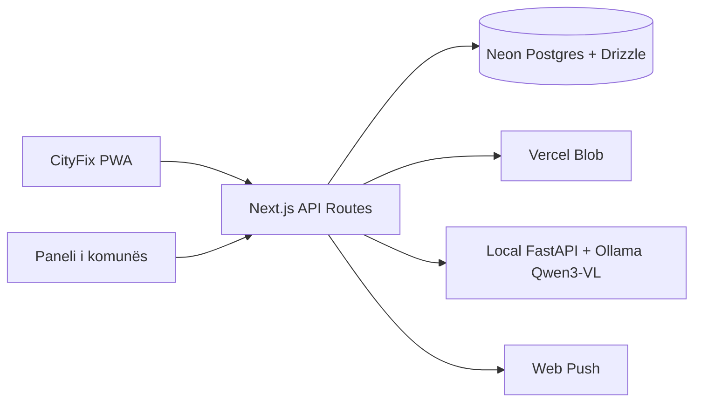
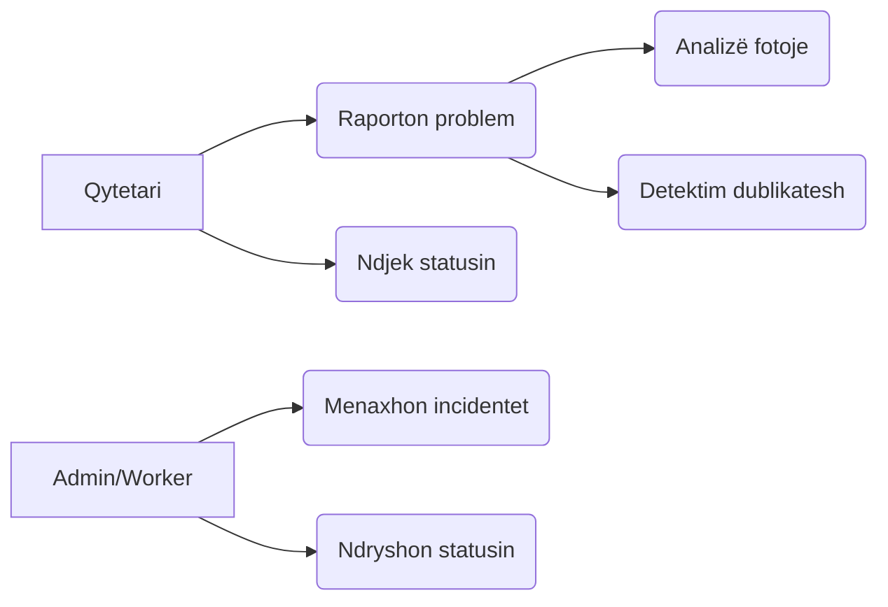
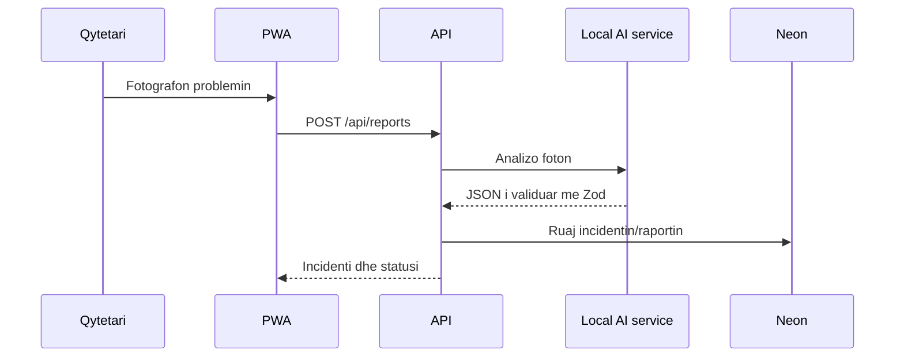
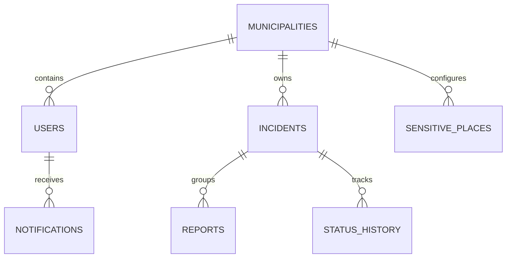

# CityFix — Projektimi i sistemit

## Përmbledhje

CityFix është platformë mobile-first për raportimin e problemeve komunale në Prishtinë dhe Deçan. Qytetari fotografon problemin, jep lokacionin dhe merr një përshkrim fillestar në shqip nga AI. Komuna i menaxhon incidentet në panelin administrativ.

## Arkitektura

## Rast përdorimi

## Sekuenca e raportimit

## Modeli i të dhënave

## Vendimet teknike

- Next.js App Router dhe TypeScript: UI dhe API në një repo, me deploy të thjeshtë në Vercel.
- Neon + Drizzle: PostgreSQL pa server të dedikuar dhe queries të parametrizuara.
- Zod: çdo payload i API-së validohet para përdorimit.
- Local AI is enabled only during local development; Vercel keeps `AI_ENABLED=false` and never calls the personal PC.
- Dështimi ose mungesa e AI-së nuk e bllokon raportin manual dhe ruhet me statusin `unavailable`.
- Algoritmet e dublikateve dhe prioritetit janë të ndara në `lib/domain.ts` dhe të testueshme pa databazë.
